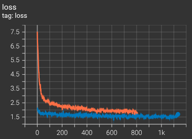
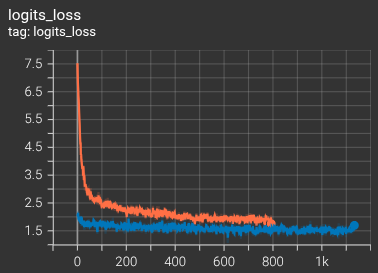
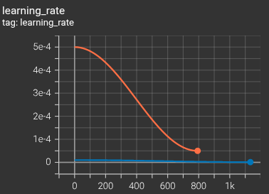

# MiniMind

**"The Great Way is Simple"**

Train an ultra-small (~64M) language model **entirely from scratch** on a single local GPU — pretraining, instruction tuning, RL, tool use, and more — with a minimalist, fully native-PyTorch implementation and a live TensorBoard dashboard.

[Quick Start](#-quick-start) · [Step-by-Step Commands](#-step-by-step-commands) · [Evaluation Arguments](#-evaluation-arguments) · [Training Data](#-what-the-transformer-trains-on) · [TensorBoard](#-tensorboard-dashboard-from-localhost) · [Training Results](#-training-results)

---

MiniMind is both an end-to-end reproduction of the LLM training pipeline and a hands-on tutorial for learning how LLMs are built. Every core algorithm (pretrain, SFT, LoRA, DPO, PPO/GRPO/CISPO, distillation, tokenizer, MoE) is implemented from scratch in native PyTorch — no `transformers`/`trl`/`peft` wrappers — so you can follow every line. The full pipeline is reproducible on an ordinary personal GPU in a few hours at a few dollars of compute.

> **Reference hardware:** a single NVIDIA **A30 / RTX 3090 (24 GB)**. The "Zero" model reproduces in roughly **2–2.5 h**. All training commands run **from the `trainer/` directory** unless stated otherwise.

---

## ⚙️ Quick Start

```bash
# 1. Get the code & install
git clone --depth 1 https://github.com/jingyaogong/minimind
cd minimind
pip install -r requirements.txt
pip install torch --index-url https://download.pytorch.org/whl/cu121   # match your CUDA
pip install tensorboard

# 2. Download the quick-reproduction data into ./dataset/
pip install modelscope
modelscope download --dataset gongjy/minimind_dataset \
  --include "pretrain_t2t_mini.jsonl" "sft_t2t_mini.jsonl" \
  --local_dir ./dataset

# 3. Pretrain  ->  SFT  (with TensorBoard logging)
cd trainer
python train_pretrain.py  --use_tensorboard
python train_full_sft.py  --use_tensorboard

# 4. Chat with the result
cd ..
python eval_llm.py --weight full_sft

# 5. (Second terminal) Watch the curves from your laptop
tensorboard --logdir runs --host 0.0.0.0 --port 6006     # on the server
ssh -N -L 6006:localhost:6006 user@serverIP               # on your laptop
# -> open http://localhost:6006
```

That's the whole journey: clone → download data → pretrain → SFT → chat → watch it learn.

---

## ⚙️ Prerequisites & Environment Setup

### Step 0.1 — Verify your GPU is visible

```bash
nvidia-smi
```

- ✅ **If you see your GPU** → continue.

- ❌ **If it says `No devices were found` / `Command not found`** → the driver is missing or not loaded. On Ubuntu:

  ```bash
  sudo apt-get update
  sudo ubuntu-drivers autoinstall
  sudo reboot
  nvidia-smi
  ```

> The GPU may be physically present (visible via `lspci | grep -i nvidia`) yet invisible to `nvidia-smi` until the kernel driver is installed/loaded.

### Step 0.2 — Install PyTorch with CUDA

Pick the `cuXXX` index matching your `nvidia-smi` CUDA version ([https://download.pytorch.org/whl/torch_stable.html](https://download.pytorch.org/whl/torch_stable.html)).

```bash
pip install torch torchvision --index-url https://download.pytorch.org/whl/cu121
```

### Step 0.3 — Project dependencies + TensorBoard

```bash
cd /path/to/minimind
pip install -r requirements.txt
pip install tensorboard
```

### Step 0.4 — Confirm Python sees the GPU

```bash
python -c "import torch; print('CUDA:', torch.cuda.is_available()); print('GPU:', torch.cuda.get_device_name(0) if torch.cuda.is_available() else 'NONE')"
# -> CUDA: True
#    GPU: NVIDIA A30
```

---

## 🚀 Step-by-Step Commands

> Run these **in order**. Each stage's output becomes the next stage's input.

### Step 1 — Download the training data

For the **fast "Zero" reproduction** (~2.3 h, ~2.8 GB), only the two `_mini` files are needed. Place them in `./dataset/`:

```bash
cd /path/to/minimind
modelscope download --dataset gongjy/minimind_dataset \
  --include "pretrain_t2t_mini.jsonl" "sft_t2t_mini.jsonl" \
  --local_dir ./dataset
```

**Hugging Face mirror**

```bash
pip install -U "huggingface_hub[cli]"
huggingface-cli download jingyaogong/minimind_dataset \
  --include "pretrain_t2t_mini.jsonl" "sft_t2t_mini.jsonl" \
  --local-dir ./dataset
```

**Full-quality reproduction (optional, ~24 GB)**

For the full `minimind-3` main-branch model, also download `pretrain_t2t.jsonl` (10 GB) and `sft_t2t.jsonl` (14 GB), and point the scripts at them with `--data_path`.

```bash
ls -lh ./dataset/
# expect: pretrain_t2t_mini.jsonl  (~1.2GB)  sft_t2t_mini.jsonl  (~1.6GB)
```

### Step 2 — Pretraining (required)

Teaches the model language patterns via next-token prediction.

```bash
cd /path/to/minimind/trainer
python train_pretrain.py --use_tensorboard
```

- Weights → `../out/pretrain_768.pth`
- TensorBoard → `../runs/MiniMind-Pretrain/`

Variants:

```bash
torchrun --nproc_per_node N train_pretrain.py --use_tensorboard   # multi-GPU
python train_pretrain.py --use_tensorboard --from_resume 1         # resume
```

### Step 3 — Supervised Fine-Tuning (required)

Turns the pretrained base into a chat/instruction-following model. It loads the pretrain weights automatically (`--from_weight pretrain` is the default).

```bash
# still in ./trainer
python train_full_sft.py --use_tensorboard
```

- Weights → `../out/full_sft_768.pth`
- TensorBoard → `../runs/MiniMind-Full-SFT/`

### Step 4 — Test the final model

```bash
cd /path/to/minimind
python eval_llm.py --weight full_sft
```

The exact command used for the results in this repo, and a description of every argument, is in [Evaluation Arguments](#-evaluation-arguments) below.

---

## 🧪 Evaluation Arguments

`eval_llm.py` loads the native PyTorch weights from `out/` (or a `transformers`-format folder via `--load_from`) and generates replies with sampling.

### Current run

This is the command used for the sample outputs and results reported in this repo:

```bash
python eval_llm.py \
    --weight full_sft \
    --max_new_tokens 128 \
    --temperature 0.7 \
    --top_p 0.8 \
    --historys 0
```

### All arguments

| Argument | Default | Current run | Description |
| --- | --- | --- | --- |
| `--load_from` | `model` | default | `model` loads native torch weights; any other path loads a `transformers`-format model. |
| `--save_dir` | `out` | default | Directory containing the weight files. |
| `--weight` | `full_sft` | `full_sft` | Weight name prefix (`pretrain`, `full_sft`, `rlhf`, `reason`, `ppo_actor`, `grpo`, `spo`). The file loaded is `<save_dir>/<weight>_<hidden_size>[_moe].pth`. |
| `--lora_weight` | `None` | default | LoRA weight name (e.g. `lora_identity`, `lora_medical`); `None` disables LoRA. |
| `--lora_rank` | `16` | default | LoRA rank. Must match the value used in training. |
| `--hidden_size` | `768` | default | Hidden dimension. Must match the trained checkpoint. |
| `--num_hidden_layers` | `8` | default | Number of transformer layers. Must match the trained checkpoint. |
| `--use_moe` | `0` | default | `1` to use the MoE architecture, `0` for the dense model. |
| `--inference_rope_scaling` | off | default | Flag. Enables 4x RoPE position extrapolation (fixes positional encoding only, not real long-context ability). |
| `--max_new_tokens` | `8192` | `128` | Maximum number of generated tokens per reply. Replies longer than this are cut off mid-sentence. |
| `--temperature` | `0.85` | `0.7` | Sampling temperature; higher is more random. |
| `--top_p` | `0.95` | `0.8` | Nucleus sampling threshold; lower is more conservative. |
| `--open_thinking` | `0` | default | `1` enables adaptive thinking mode. |
| `--historys` | `0` | `0` | Number of previous chat turns to include (must be even). `0` means every prompt is answered with no history. |
| `--show_speed` | `1` | default | Print decode speed in tokens/s after each reply. |
| `--device` | `cuda` if available, else `cpu` | default | Inference device. |

### Notes

- On start-up the script asks for a mode: `[0]` runs the built-in test prompts (currently Chinese), `[1]` lets you type your own prompts.
- Sampling is always on (`do_sample=True`), and `repetition_penalty` is fixed to `1` in the `generate()` call, so there is no repetition penalty unless you edit the script.
- For `pretrain` weights the prompt is fed as raw text after the BOS token; for all other weights the chat template is applied.
- A new random seed is drawn for every prompt, so answers differ between runs.

---

## 📊 What the Transformer Trains On

Three stages, three data types (all JSONL, all in `./dataset/`):

| Stage             | File(s)                                      | Format                                   | What it teaches                                                            |
| ----------------- | -------------------------------------------- | ---------------------------------------- | -------------------------------------------------------------------------- |
| **Pretrain**      | `pretrain_t2t(_mini).jsonl`                  | `{"text": "..."}`                        | Language + world knowledge via next-token prediction. Chinese–English mix. |
| **SFT**           | `sft_t2t(_mini).jsonl`                       | `{"conversations":[{"role","content"}]}` | Instruction following, multi-turn chat, tool-calling, thinking.            |
| **RL** (optional) | `dpo.jsonl`, `rlaif.jsonl`, `agent_rl.jsonl` | preference pairs / SFT-style prompts     | Preference alignment (DPO), RLAIF (PPO/GRPO/CISPO), agentic tool use.      |

**Pretrain data** — plain text, one `{"text": ...}` per line, from general corpora, curated dialogue, and distillation corpora under permissive licenses (Craftsman, Magpie-Align, …), all cleaned, deduplicated, and length-controlled.

**SFT data** — multi-turn dialogues with `system / user / assistant / tool` roles. Much of it is synthetic data distilled from stronger models (Qwen3, DeepSeek-R1, R1-Distill-SFT, COIG, Step-3.5-Flash-SFT…), plus ~100K tool-calling samples and reasoning/thinking data.

```json
{"conversations": [
  {"role": "user", "content": "你好"},
  {"role": "assistant", "content": "你好！"}
]}
```

**In one line:** big clean raw text (zh/en) → high-quality instruction + distilled + tool-calling dialogues → (optional) preference/RL data. Pretrain gives the language, SFT shapes the chatbot, RL polishes the quality.

---

## 📈 TensorBoard Dashboard from localhost

The `--use_tensorboard` flag writes `loss`, `logits_loss`, `aux_loss`, `learning_rate`, and `epoch_time` to event files under `runs/<project>/`. View them from your laptop over an SSH tunnel.

```bash
# 1. Server (2nd terminal):
cd /path/to/minimind
tensorboard --logdir runs --host 0.0.0.0 --port 6006

# 2. Laptop:
ssh -N -L 6006:localhost:6006 user@serverIP

# 3. Open http://localhost:6006
```

Both the Pretrain and Full-SFT runs appear as separate runs in one dashboard.

> The x-axis is the log-interval index (same convention as wandb/SwanLab), not raw optimizer steps.

---

## 📉 Training Results

TensorBoard curves from the current run. Both stages are drawn in the same chart:

- 🟠 **Orange — Pretrain** (peak learning rate `5e-4`)
- 🔵 **Blue — Full SFT** (learning rate around `1e-5`)

The x-axis is the log-interval index (one point per `--log_interval` steps, default 100), not raw optimizer steps.

### Loss



### Logits loss



`loss` and `logits_loss` overlap exactly here: the model is dense (no MoE), so `aux_loss` is 0 and `loss = logits_loss`.

### Learning rate



### Summary

Approximate values read off the plots:

| Stage | Logged points | Start LR | End LR | Start loss | End loss |
| --- | --- | --- | --- | --- | --- |
| Pretrain | ~800 | `5e-4` | ~`5e-5` | ~7.5 | ~1.8 |
| Full SFT | ~1.1k | ~`1e-5` | ~`0` | ~2.0 | ~1.6 |

- Pretraining uses a cosine-style decay from `5e-4`; the loss drops quickly in the first ~100 points and then flattens around 1.8–2.0.
- SFT starts from the pretrained weights (hence the lower starting loss) with a much smaller learning rate, and settles around 1.5–1.7.

---

## 🧩 Optional Extra Training Stages

Run from `./trainer` (serving/eval from the repo root). Add `--use_tensorboard` to any metric-logging `train_*.py`.

| Task                      | Command                                   | Extra data       |
| ------------------------- | ----------------------------------------- | ---------------- |
| LoRA                      | `python train_lora.py`                    | a `lora_*.jsonl` |
| RLHF / DPO                | `python train_dpo.py`                     | `dpo.jsonl`      |
| RLAIF (PPO/GRPO)          | `python train_grpo.py`                    | `rlaif.jsonl`    |
| Agentic RL                | `python train_agent.py`                   | `agent_rl.jsonl` |
| Distillation              | `python train_distillation.py`            | a teacher model  |
| OpenAI-compatible API     | `python scripts/serve_openai_api.py`      | —                |
| WebUI                     | `cd scripts && streamlit run web_demo.py` | —                |
| Merge LoRA → full weights | `cd scripts && python convert_model.py`   | —                |

---

## 🗂️ File Layout

```
minimind/
├── dataset/        # training data
├── trainer/        # run all training from here
│   └── tb_utils.py # TensorBoard logger
├── model/          # architecture + tokenizer (no weights)
├── scripts/        # API server, WebUI, conversion
├── assets/         # training plots used in this README
├── out/            # -> produced weights (pretrain_768.pth, full_sft_768.pth)
├── runs/           # -> TensorBoard event files
└── checkpoints/    # -> resume checkpoints
```

---

## 🛠️ Troubleshooting

| Symptom                                | Fix                                                                          |
| -------------------------------------- | ---------------------------------------------------------------------------- |
| `nvidia-smi` → *No devices were found* | Install/load the driver, then reboot. GPU may still show in `lspci`.         |
| `torch.cuda.is_available()` → `False`  | Reinstall PyTorch with the correct `--index-url .../cu121`.                  |
| `ModuleNotFoundError: tensorboard`     | `pip install tensorboard`                                                    |
| No TB runs yet                         | Training hasn't hit the first `log_interval` (default 100 steps).            |
| Can't reach TensorBoard from laptop    | Ensure `--host 0.0.0.0 --port 6006` **and** the `ssh -L` tunnel are both up. |
| Out of VRAM                            | Lower `--batch_size` and/or `--max_seq_len`.                                 |
| Crash mid-run                          | Restart with `--from_resume 1`.                                              |

### Common flags (`train_pretrain.py` / `train_full_sft.py`)

```
--batch_size 32         --max_seq_len 340/768   --learning_rate 5e-4 / 1e-5
--epochs 2              --accumulation_steps 8  --grad_clip 1.0
--log_interval 100      --save_interval 1000    --device cuda:0
--dtype bfloat16        --data_path ../dataset/...
--use_tensorboard       --tb_dir ../runs        --use_wandb   (TB wins if both set)
--from_weight pretrain  --from_resume 1
```

---

Released under the **Apache 2.0** license. MiniMind is a reproducible, readable starting point for understanding — and training — language models from 0 to 1.
